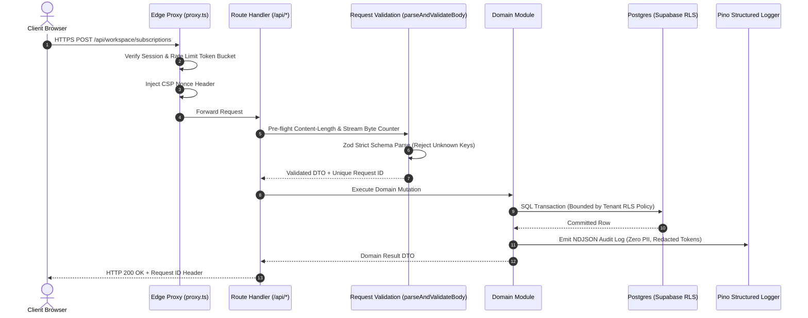
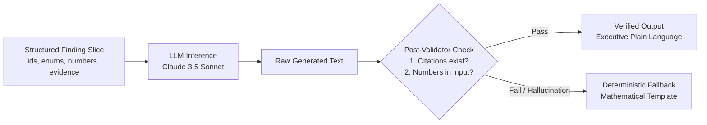

# SpendLens System Architecture

SpendLens is engineered as a **Modular Monolith** designed for high auditability, multi-tenant isolation, and mathematically verifiable financial reporting.

---

## 1. Module Boundaries

The codebase is organized into four decoupled domain modules under `src/modules/`, each with explicit public interfaces and internal encapsulation:

```
src/modules/
├── audit/          # Pure deterministic rule engine & pricing catalog
├── workspace/      # Multi-tenant domain, subscriptions, TanStack table, CSV streaming
├── ai/             # Grounded plain-language insight generator & numeric validator
└── security/       # Envelope encryption, sliding-window rate limiters, CSRF, audit log
```

### Module Responsibilities
- **`src/modules/audit`**:
  - Pure, side-effect-free library. Zero database queries, zero HTTP calls, zero floating-point operations.
  - Represents money strictly as 64-bit integer minor units (cents) via `MoneyMinor = bigint | number`.
  - Driven by the verified [`pricing_catalog.ts`](file:///C:/Users/Anubhav07/.gemini/antigravity/worktrees/Automation/spendlens_workspace_init/project/credex-audit-main/src/modules/audit/pricing_catalog.ts), tracking verified vendor source URLs and timestamps. Resolves the ChatGPT Team conflict ($25/seat/mo annual vs $30/seat/mo monthly) explicitly from vendor pages.
  - Generates structured `Finding` objects and guarantees no double counting via a dedicated single-winner resolver.
- **`src/modules/workspace`**:
  - Manages tenant lifecycle, subscriptions, categories, owners, and renewal tracking.
  - Powers the server-paginated TanStack table with column sorting, category filtering, search, and CSV export.
  - Features a resilient, chunk-validated CSV streaming import engine with atomic batch insertion and instantaneous rollback capabilities.
- **`src/modules/ai`**:
  - Rewrites structured findings into executive plain-language answers across five question types (`spend_analysis`, `vendor_comparison`, `renewals`, `budgets`, `savings`).
  - Completely isolated from raw database queries, user emails, and raw rows.
  - Enforces mandatory `[finding_id]` citations and runs a strict post-validator that automatically rejects any output containing numbers not present in the input.
- **`src/modules/security`**:
  - AES-256-GCM envelope encryption for sensitive tokens using HKDF-SHA256 derived Key Encryption Keys (KEKs).
  - Sliding-window rate limiters returning HTTP 429 with `Retry-After`.
  - Double-submit HMAC-SHA256 CSRF verification and session rotation.
  - Immutable audit logging ledger restricted to `owner` and `admin` roles.

---

## 2. Data Flow Architecture

The lifecycle of an incoming mutation follows a strict unidirectional verification pipeline:



---

## 3. The Trust Boundary (What the Server Owns)

In SpendLens, the client browser is treated as an entirely untrusted, potentially hostile presentation layer.

### What the Server Strictly Owns and Enforces:
1. **Pricing and Calculations**: The client never submits calculated savings or unit costs. The server looks up official plans in `pricing_catalog.ts` and calculates minor-unit differentials server-side.
2. **Tenant Membership & Role Boundaries**: Permissions (`owner`, `admin`, `member`) are re-evaluated inside every server action and route handler. Even if edge proxy headers were spoofed, database RLS policies enforce `user_id = auth.uid()`.
3. **Audit Log Ledger**: The client cannot omit or fabricate audit log entries. Sensitive operations (`role_change`, `csv_import`, `workspace_delete`) write immutable audit entries inside the server transaction.
4. **Data Encryption Keys (DEKs)**: Master Key Encryption Keys (KEKs) and HMAC secrets reside strictly in server environment memory (`src/lib/env.ts`) and are never exposed via `NEXT_PUBLIC_` variables.

---

## 4. Why a Modular Monolith and PostgreSQL?

### Why a Modular Monolith?
- **Zero Network Latency Between Modules**: Microservice architectures introduce distributed transaction overhead, serialization delays, and cascading failures. SpendLens domain modules communicate via strongly-typed, in-process TypeScript interfaces.
- **Atomic Consistency**: Actions such as importing a CSV batch, updating price histories, and writing an audit log entry occur within a single database transaction.
- **Unified Deployment & Single Lockfile**: One repository, one lockfile (`package-lock.json`), and atomic pull requests eliminate cross-service version mismatches.

### Why PostgreSQL?
- **Relational Integrity for Financial Data**: SaaS subscriptions and price histories require strict ACID foreign-key constraints. Soft or non-relational document stores (e.g. MongoDB) risk orphaned records and silent ledger divergence.
- **Row-Level Security (RLS)**: Postgres evaluates multi-tenant security natively in the kernel on every query, providing a defense-in-depth layer beneath the application code.
- **Expressive Indexing**: Composite B-tree indexes, covering indexes (`INCLUDE`), and range operators (`BETWEEN`) power sub-millisecond aggregations on multi-million row datasets.

---

## 5. How Tenant Isolation Works

SpendLens enforces tenant isolation across two independent layers:

### Layer 1: Application-Level Scoping
Every domain repository query explicitly requires `workspaceId` as its primary parameter:
```typescript
// subscriptions.ts
export async function getSubscriptionById(
  workspaceId: string,
  subscriptionId: string
): Promise<Subscription | null> {
  const store = getStore(workspaceId);
  return store.find((s) => s.workspaceId === workspaceId && s.id === subscriptionId) || null;
}
```
If a user in Workspace B attempts an IDOR read or update using an ID belonging to Workspace A, the query returns `null` or throws `"Subscription not found."`.

### Layer 2: Kernel-Level Postgres RLS
All database tables enforce Row-Level Security via a PostgreSQL security-definer helper function:
```sql
CREATE OR REPLACE FUNCTION is_workspace_member(ws_id UUID)
RETURNS BOOLEAN AS $$
BEGIN
  RETURN EXISTS (
    SELECT 1 FROM workspace_members
    WHERE workspace_id = ws_id
      AND user_id = auth.uid()
  );
END;
$$ LANGUAGE plpgsql SECURITY DEFINER;

CREATE POLICY "Workspace members can view subscriptions"
  ON subscriptions FOR SELECT
  USING (is_workspace_member(workspace_id));
```
Even if an application-layer bug omitted the `workspace_id` filter, PostgreSQL automatically rewrites the query planner to restrict row visibility strictly to organizations where `auth.uid()` holds active membership.

---

## 6. How the AI Layer is Grounded

The SpendLens AI architecture was designed with a fundamental rule: **the LLM is an executive text formatter, not a calculator or query engine.**



### The 4 Grounding Pillars:
1. **Strict Input Isolation**: The model never receives free-text user prompts, customer emails, or raw database rows. It receives only pre-computed, deterministic `StructuredFindingInput` objects produced by `src/modules/audit`.
2. **Read-Only Zod-Typed Workspace Tools**: The model answers questions through five pre-defined tool functions (`get_spend_overview`, `list_findings`, `compare_vendors`, `get_upcoming_renewals`, `get_budget_status`). No arbitrary SQL or mutation tools exist.
3. **Mandatory Finding Citation**: Every sentence generated by the model must cite a valid finding ID (e.g. `[f_cursor_01]`). The UI maps citations directly to click-to-evidence side sheets.
4. **Automated Numeric Post-Check**: Before any answer is displayed to a user, [`post_validator.ts`](file:///C:/Users/Anubhav07/.gemini/antigravity/worktrees/Automation/spendlens_workspace_init/project/credex-audit-main/src/modules/ai/post_validator.ts) extracts all numbers, currency amounts, and percentages from the model's text. If any number is detected that was not explicitly present in the input context, the response is discarded and the system falls back to the deterministic output.

