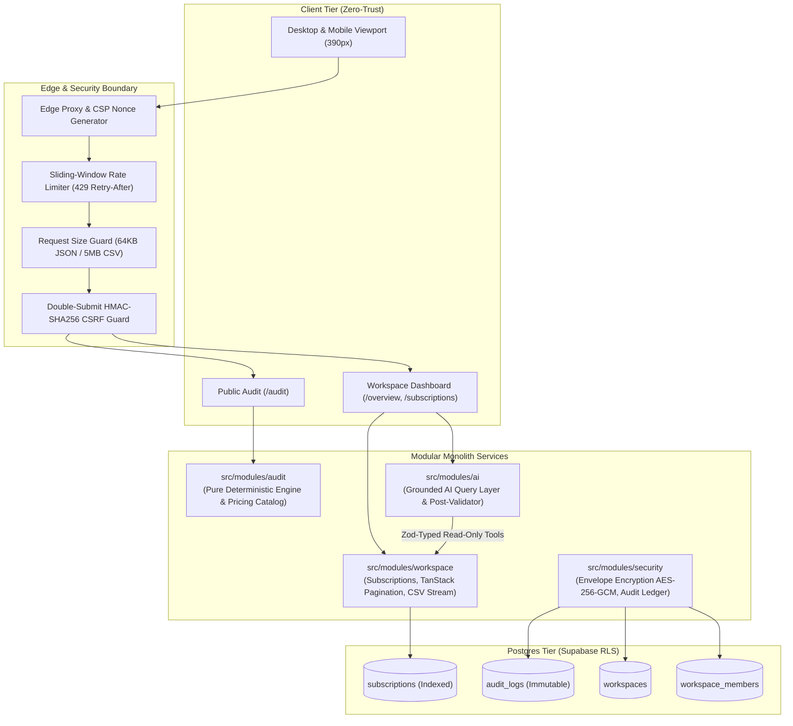

# SpendLens • Institutional AI & SaaS Spend Intelligence

[](https://github.com/spendlens/spendlens/actions/workflows/ci.yml)
[](./src/__tests__)
[](./tsconfig.json)
[](./LICENSE)

SpendLens is a calm, dense, finance-grade SaaS and AI spend intelligence workspace built for modern engineering organizations. It eliminates shadow IT sprawl, identifies duplicate AI subscriptions, flags seats exceeding active team sizes, surfaces upcoming renewal cliffs, and grounds plain-language insights with zero hallucinated figures.

---

## The Problem

Engineering and product teams adopt AI coding assistants, chat models, and API credits at unprecedented speed. Within 6 months, organizations face:
1. **Tool Overlap & Duplication**: Teams simultaneously pay for Cursor Business ($40/seat/mo) and GitHub Copilot ($19/seat/mo), or Claude Team ($30/seat/mo) and ChatGPT Team ($25/seat/mo).
2. **Seat Bloat**: Companies purchase 25 seats for a 12-person team because no one pruned former contractors or inactive members.
3. **Renewal Surprises**: Multi-thousand-dollar annual contracts auto-renew on 30-day notice windows without finance or engineering review.
4. **Unverifiable "Savings" Claims**: Generic SaaS management tools generate vague AI summaries with hallucinated savings numbers that CFOs cannot audit or trust.

SpendLens solves this with a **pure, deterministic rules engine**, **minor-unit integer accounting**, **dual-layer tenant isolation**, and a **strictly grounded AI query interface**.

---

## Who It Is For

- **CFOs & Finance Directors**: Demanding provable numbers tied to real vendor pricing catalogs, auditable CSV exports, and predictable renewal calendars.
- **VPs of Engineering & Tech Leads**: Seeking clarity on developer tool utilization without disrupting active engineering workflows.
- **Operations & Procurement**: Requiring an immutable audit ledger of role changes, contract status reviews, and data lifecycle management.

---

## Architecture Overview

SpendLens is built as an institutional **Modular Monolith** in Next.js and TypeScript, backed by PostgreSQL Row-Level Security (RLS).



---

## Local Setup (Under 5 Minutes)

### Prerequisites
- Node.js >= 20.x
- npm >= 10.x

### 1. Clone & Install Dependencies
```bash
git clone https://github.com/spendlens/spendlens.git
cd spendlens/project/credex-audit-main
npm ci
```

### 2. Configure Environment Variables
Copy the example environment configuration:
```bash
cp .env.example .env.local
```

Populate the minimal local variables:
```env
NEXT_PUBLIC_APP_URL="http://localhost:3000"
NEXT_PUBLIC_SUPABASE_URL="https://mock.supabase.co"
NEXT_PUBLIC_SUPABASE_ANON_KEY="mock-anon-key"
SUPABASE_SERVICE_ROLE_KEY="mock-service-role-key"
# Generate 64-character hex keys with: openssl rand -hex 32
ENCRYPTION_MASTER_KEY=
CSRF_SECRET=
```

### 3. Verify Local Build & Test Suite
```bash
# Run unit & integration test suite (134 tests)
npm test

# Verify TypeScript compilation (0 errors)
npx tsc --noEmit

# Run Next.js development server
npm run dev
```
Open [http://localhost:3000](http://localhost:3000) in your browser.

---

## Environment Variables Reference

| Variable | Scope | Required (Prod) | Purpose |
|---|---|---|---|
| `NEXT_PUBLIC_APP_URL` | Client + Server | **Yes** | Base application URL for OAuth callbacks, share tokens, and metadata |
| `NEXT_PUBLIC_SUPABASE_URL` | Client + Server | **Yes** | Supabase REST/Postgres gateway URL |
| `NEXT_PUBLIC_SUPABASE_ANON_KEY` | Client + Server | **Yes** | Public anon key for Row-Level Security authentication |
| `SUPABASE_SERVICE_ROLE_KEY` | Server Only | **Yes** | Admin service key for tenant management (never sent to client) |
| `ENCRYPTION_MASTER_KEY` | Server Only | **Yes** | 64-character hex master key for AES-256-GCM envelope encryption |
| `CSRF_SECRET` | Server Only | **Yes** | 64-character hex secret for double-submit HMAC CSRF signatures |
| `ANTHROPIC_API_KEY` | Server Only | Optional | Claude 3.5 API key for grounded plain-language insights |
| `NEXT_PUBLIC_SENTRY_DSN` | Client + Server | Optional | Sentry crash reporting and error boundary telemetry |
| `FLAG_<KEY>` | Server Only | Optional | Feature flag override (e.g. `FLAG_GMAIL_AUTO_SYNC=true`) |

---

## Scripts & CLI Commands

```bash
# Development server (hot reload)
npm run dev

# Production build with Webpack & static page generation
npm run build

# Start production server
npm run start

# ESLint code quality check
npm run lint

# Vitest test suite execution
npm test

# Vitest interactive watcher
npm run test:watch

# End-to-End Playwright test suite (Chromium, WebKit, Mobile)
npx playwright test
```

---

## Testing & Quality Gates

SpendLens enforces a 4-tier test pyramid:

1. **Deterministic Unit Tests**: Verifies every calculation rule across boundary seat counts (1, team size, team size + 1).
2. **Property-Based Tests (`fast-check`)**: Mathematically asserts that:
   - Savings are always $\ge 0$.
   - Annual cost equals exactly $12 \times \text{monthly}$ in minor units with zero rounding drift.
   - Output is independent of subscription input ordering.
   - Idempotency: executing twice with the same input yields identical findings.
   - No subscription is ever double-counted across conflicting rules.
3. **API Integration Tests**: Real route handler tests for `/api/health`, `/api/vitals`, `/api/audit`, `/api/lead`, `/api/unsubscribe`, `/api/workspace/export`, and `/api/workspace/delete`.
4. **End-to-End Playwright Lifecycle**: Automated journey across Desktop and 390px Mobile viewports executing `audit -> share -> signup -> subscriptions -> CSV import -> AI insight`.

---

## Deployment & Production Notes

- **Vercel / Node Container**: SpendLens deploys natively to Vercel or any containerized Node.js 20+ runtime.
- **Security Headers**: Injects HSTS (`max-age=63072000; includeSubDomains; preload`), `X-Content-Type-Options: nosniff`, `X-Frame-Options: DENY`, strict `Permissions-Policy`, and cryptographically generated CSP nonces per request.
- **Database Migrations**: Applied via Supabase CLI (`supabase migration up`). Zero direct DDL modifications permitted in production.
